

  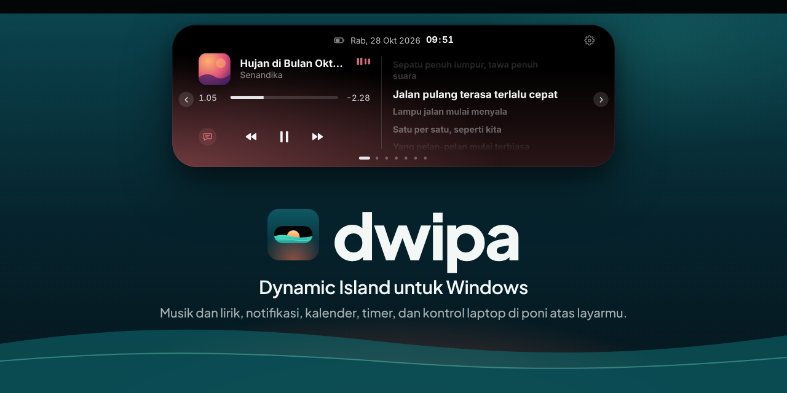

  <a href="../../releases/latest"><b>⬇ Unduh Dwipa untuk Windows</b></a>
  &nbsp;&nbsp;|&nbsp;&nbsp;
  Windows 10 & 11 (64-bit)
  &nbsp;&nbsp;|&nbsp;&nbsp;
  Gratis

---

**Dwipa** menaruh pil hitam kecil di tengah atas layar, seperti poni di iPhone dan MacBook. Saat diam ia hanya menampilkan jam atau lagu yang sedang diputar. Arahkan kursor ke atasnya, dan pil melebar menjadi panel berisi musik, lirik, kalender, timer, dan kontrol laptop. Klik di sekitar pil tetap tembus ke aplikasi di belakangnya, jadi tidak mengganggu kerja.

  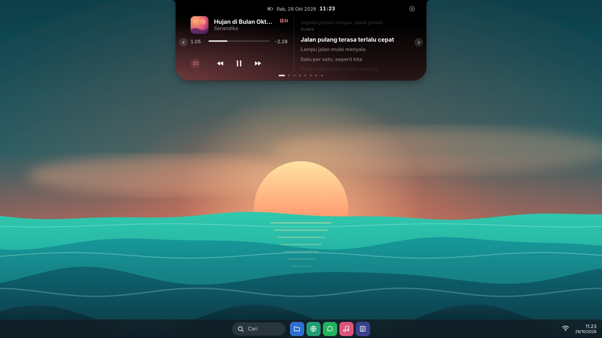

<table>
  <tr>
    <td width="50%">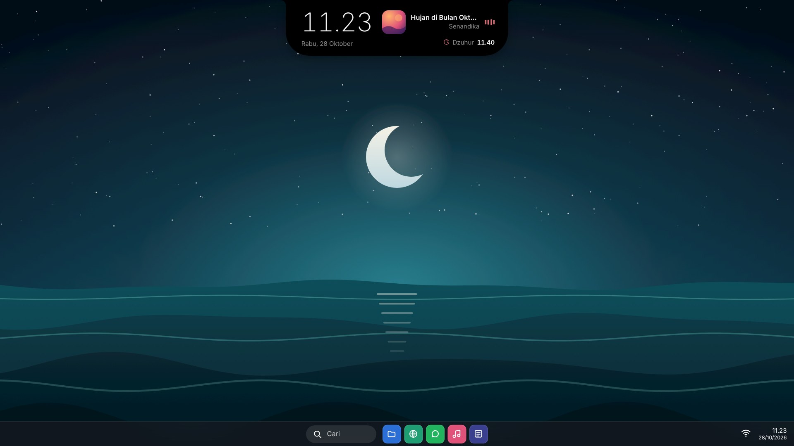</td>
    <td width="50%">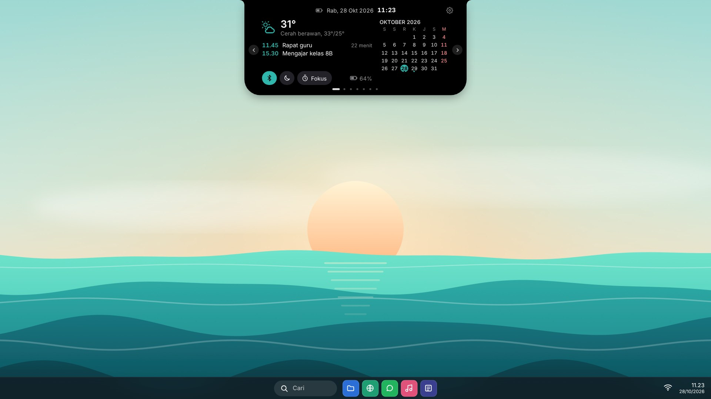</td>
  </tr>
  <tr>
    <td width="50%">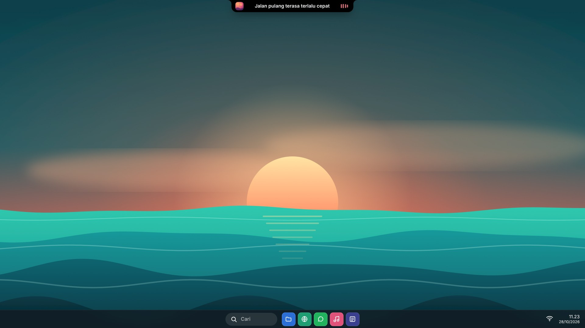</td>
    <td width="50%">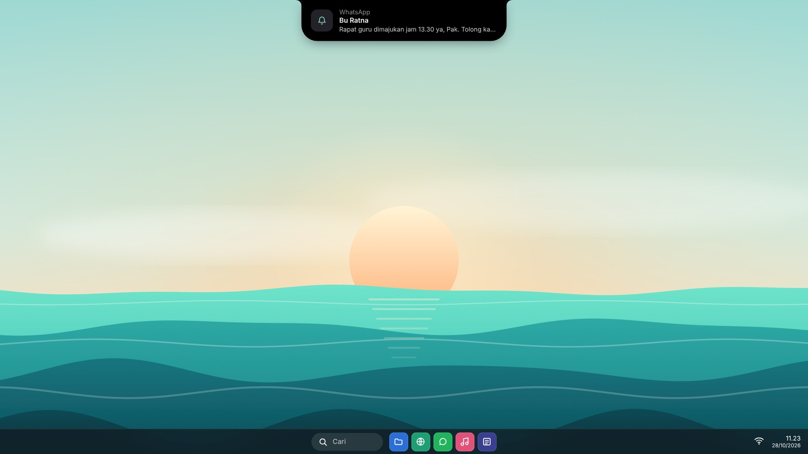</td>
  </tr>
</table>

  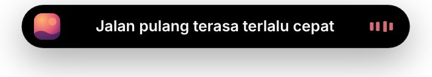

## Isinya

<table>
  <tr>
    <td width="50%">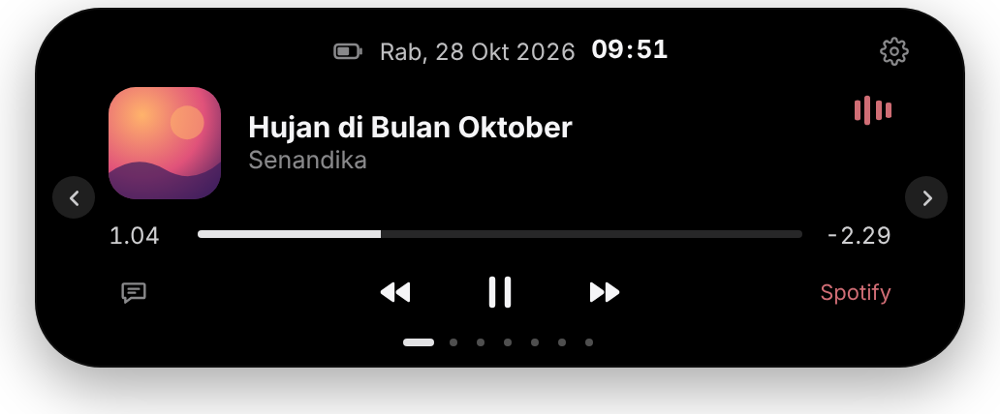</td>
    <td width="50%">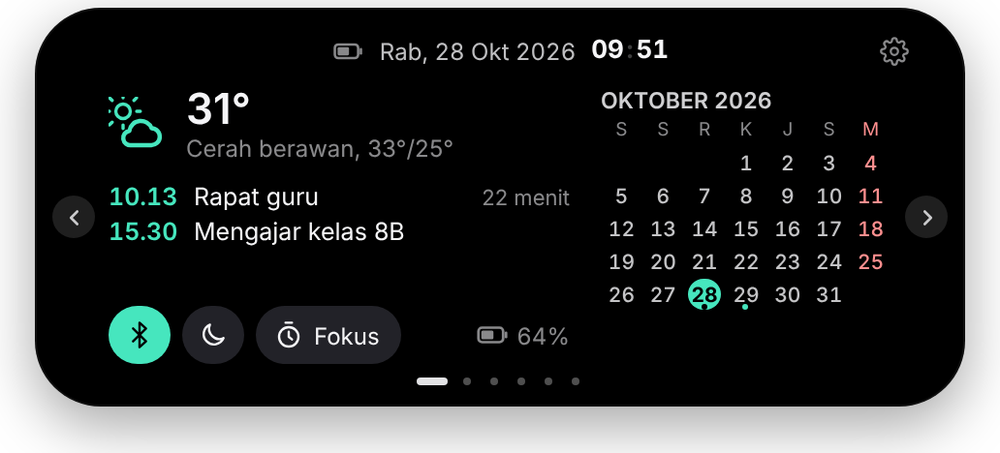</td>
  </tr>
  <tr>
    <td><b>Musik.</b> Spotify, YouTube, VLC, dan pemutar lain. Ganti lagu, jeda, dan klik progres untuk loncat.</td>
    <td><b>Beranda.</b> Cuaca, agenda dari Google Calendar, kalender bulan ini, dan tombol cepat.</td>
  </tr>
  <tr>
    <td>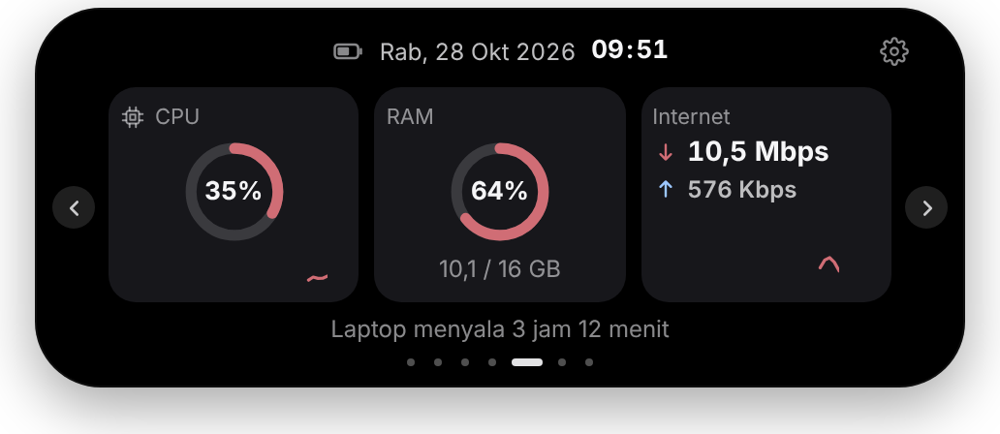</td>
    <td>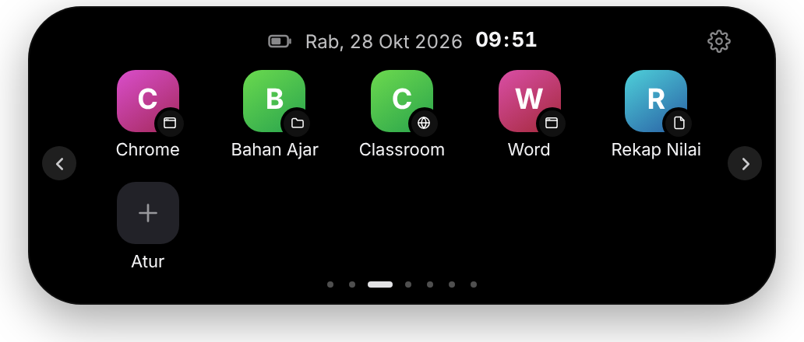</td>
  </tr>
  <tr>
    <td><b>Sistem.</b> CPU, RAM, dan kecepatan internet secara langsung.</td>
    <td><b>Pintasan.</b> Aplikasi, folder, dan situs favorit sekali klik.</td>
  </tr>
</table>

  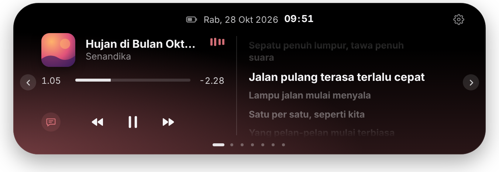
   Mode lirik: lirik bergulir mengikuti lagu, latar berwarna dari cover album.

**Juga ada:**

- Layar istirahat: jam besar saat laptop tidak disentuh
- Cahaya "bernapas" di bawah pil saat diam, warnanya ikut waktu
- Animasi saat charger dicolok, tepi pil berdenyut saat baterai hampir habis
- Pratinjau screenshot (`Win + Shift + S`): seret langsung ke WhatsApp
- Pengumuman tim: satu klik, muncul di pil semua laptop kantor
- Jadwal sholat (opsional), kriteria Kemenag RI, tanpa internet
- Catatan / daftar tugas cepat
- Indikator Caps Lock dan bahasa keyboard
- Lirik berjalan di pil, sinkron dengan lagu
- Notifikasi WhatsApp, Telegram, dan email muncul di pil; klik untuk membuka aplikasinya
- Titik hijau/oranye saat kamera atau mikrofon sedang dipakai
- Pop-up volume dan kecerahan yang beranimasi
- TWS tersambung lengkap dengan baterainya
- Timer dan pomodoro, sisa waktunya melingkari pil
- Rak file (seret masuk, seret keluar) dan riwayat clipboard
- Shortcut `Win + Alt + Spasi` untuk membuka panel
- Sembunyi otomatis saat main game atau nonton layar penuh
- Update otomatis

  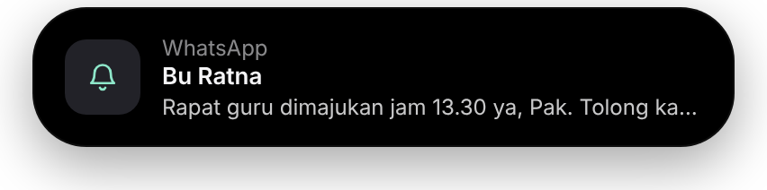

<table>
  <tr>
    <td width="50%">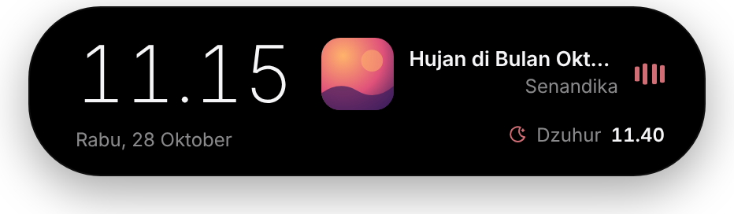</td>
    <td width="50%">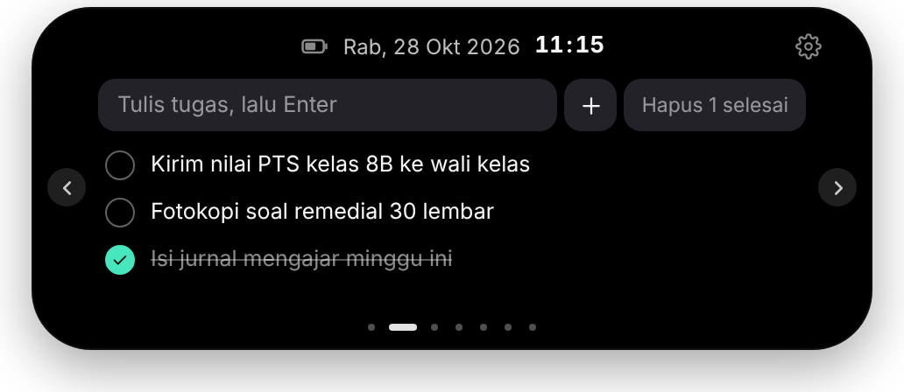</td>
  </tr>
  <tr>
    <td><b>Layar istirahat.</b> Jam besar, lagu yang diputar, dan sholat/agenda berikutnya saat laptop ditinggal.</td>
    <td><b>Catatan.</b> Daftar tugas cepat, langsung dari pil.</td>
  </tr>
</table>

  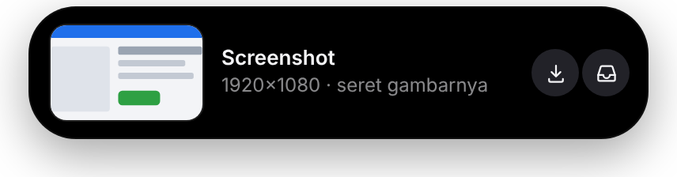
   Setelah Win + Shift + S: seret gambarnya langsung ke WhatsApp atau folder.

## Wallpaper

Biar desktopmu sama seperti di gambar, pakai wallpaper Dwipa (4K, gratis). Klik gambarnya untuk mengunduh, lalu klik kanan file → **Jadikan latar belakang desktop**.

<table>
  <tr>
    <td width="33%"></td>
    <td width="33%"></td>
    <td width="33%"></td>
  </tr>
  <tr>
    <td align="center"><b>Senja</b></td>
    <td align="center"><b>Malam</b></td>
    <td align="center"><b>Pagi</b></td>
  </tr>
</table>

Tips: pilih bentuk **Poni** di Pengaturan supaya pil menyatu dengan tepi atas layar seperti di gambar.

## Cara memasang

1. Buka halaman [**Releases**](../../releases/latest), unduh file `Dwipa_x.y.z_x64-setup.exe`.
2. Jalankan file itu. Kalau muncul layar biru **"Windows protected your PC"**, klik **More info → Run anyway**. Peringatan ini muncul karena Dwipa belum memakai sertifikat berbayar, bukan karena berbahaya.
3. Pil muncul di tengah atas layar. Klik kanan ikon Dwipa di system tray (pojok kanan bawah) → **Pengaturan…** untuk:
   - mengisi kota untuk cuaca,
   - menempelkan link kalender (Google Calendar → Setelan → *Alamat rahasia dalam format iCal*),
   - menyalakan **Jalankan saat Windows menyala**.
4. Saat Windows bertanya izin membaca notifikasi, pilih **Izinkan** supaya chat bisa muncul di pil.

Versi baru akan dipasang otomatis. Dwipa memberi tahu lewat pil saat ada pembaruan.

## Pertanyaan

**Apakah berat?**
Tidak. Dwipa memakai WebView2 bawaan Windows, dan animasi berhenti saat tidak terlihat. Data sistem hanya dihitung saat halamannya dibuka. Saat Battery Saver menyala, Dwipa otomatis masuk mode hemat.

**Data saya dikirim ke mana?**
Tidak ke mana-mana. Notifikasi, clipboard, screenshot, catatan, dan aktivitas kamera/mikrofon hanya dibaca di laptop sendiri. Yang mengakses internet hanya pencarian lirik ([LRCLIB](https://lrclib.net)), cuaca ([Open-Meteo](https://open-meteo.com)), link kalender yang kamu isi sendiri, pengumuman tim, dan pemeriksaan update.

**Liriknya tidak muncul?**
Tidak semua lagu ada di database lirik, terutama lagu yang kurang populer. Kalau liriknya terasa telat atau kecepatan, geser dengan tombol **− Timing +** di mode lirik.

**Bagaimana cara keluar atau menghapus?**
Klik kanan ikon Dwipa di tray → **Keluar**. Untuk menghapus: Pengaturan Windows → Aplikasi → Dwipa → Uninstall.
